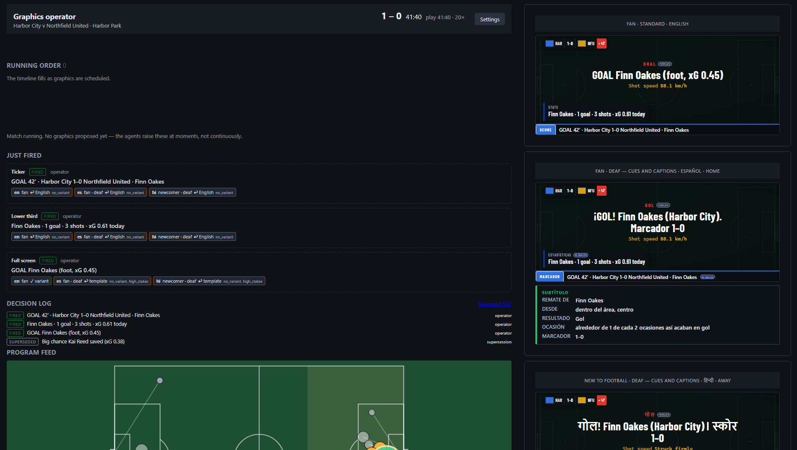

# Control Room IQ

**The AI member of the production gallery: Foundry agents propose what goes on screen, a human fires every
graphic, and the approved moment reaches deaf fans live, in their language.**



Built for the Microsoft × Premier League *Inside the Game* Developer Hackathon (October 2026).
Category: Best Enterprise Solution (also fits Best Use of Microsoft Foundry).

| | |
| --- | --- |
| Live demo (operator) | https://ca-crq-web-poc-eastus2-01.wittyground-1f27f60c.eastus2.azurecontainerapps.io/operator |
| Live demo (deaf Spanish viewer) | https://ca-crq-web-poc-eastus2-01.wittyground-1f27f60c.eastus2.azurecontainerapps.io/viewer?persona=newcomer&access=deaf&lang=es&allegiance=neutral |
| Video (under 2 minutes) | [link] |
| Tests in CI | 528 passing (364 Python + 164 TypeScript) |
| Security scans | CodeQL + Trivy + Dependabot, green on `main`; actions pinned to commit SHAs |
| Foundry evaluation | [faithfulness x.xx · relevance x.xx · fluency x.xx over N lines in EN / ES / HI] |
| Planted falsehoods | [N planted, N caught] |
| From the gallery | "[one sentence from a working control-room operator]" — [name, role] |

All match data is synthetic. Clubs, players and venues are fictional.

<!-- Before submission: fill every [bracket] or delete the row; never guess a figure. Check the walkthrough
     against the final console and update the Status column in "Built on Microsoft Foundry and Azure". -->

## For enterprise reviewers

The Best Enterprise Solution category rewards *"reliability, transparency, and controls required for
production."* Three claims, each enforced in code — see [docs/ENTERPRISE-OVERVIEW.md](docs/ENTERPRISE-OVERVIEW.md) for the full map
and [SECURITY.md](SECURITY.md) for the full posture.

- **The gate is in the schema, not in a setting.** `OverlayPacket` requires `approval_id`, `approved_by`
  and `approved_at`; the renderer refuses anything else. There is no auto-approve path and no bypass flag.
  See [`packages/schemas/crq_schemas/__init__.py:560`](packages/schemas/crq_schemas/__init__.py) and
  [`services/api/tests/test_gate.py`](services/api/tests/test_gate.py).
- **Numbers from code, words from models.** Agents may quote numbers but never compute them. Variants are
  gated by code checks (invented numbers, name drift, banned content, actually-translated, faithfulness).
  See [`services/api/api/variant_checks.py`](services/api/api/variant_checks.py).
- **Model choice is auditable.** A per-agent router (quality / balanced / cost) records the served model
  on every proposal and every OpenTelemetry span. One trace per `moment_id`. Every decision is in an
  append-only log, downloadable at `GET /decisions.csv`.
  See [`services/agents/agents/config.py`](services/agents/agents/config.py).

Enterprise substrate: managed identity + OIDC (no secrets in the repo), CodeQL + Trivy + Dependabot on
every PR, every GitHub action pinned to a full commit SHA, offline mode as a first-class path so the demo
survives model quota failure.

## What it is

A Premier League match is cut in a production gallery, where a producer decides the story and a graphics
operator fires every score, stats and caption graphic, with seconds to decide. The world feed then goes to
international broadcasters who each need it in their own language. Control Room IQ sits at the **graphics
stage** of that signal flow. It reads the match data feed, explains why a moment matters, proposes the next
graphic with its evidence, and hands the graphics the operator fires to the existing graphics engine. It
does not replace the graphics engine, the vision mixer or the director.

Three things set it apart:

- **A person fires every graphic, by design.** There is no auto-approve setting. If nobody decides, the
  console warns at 10 seconds and a timer holds the graphic at 20; a held graphic expires once the match has
  moved past it. Neither the timer nor the expiry rule can put anything on air.
- **Approve once, in English; deliver in every viewer's language.** Each viewer group gets an AI version
  of the approved line only if it passes code checks (numbers, names, length, banned topics, actually
  translated). Otherwise it gets a template line in its language, or the approved English line.
- **The deaf fan first.** A visual cue on the strike within a second, in plain code with no AI and no
  waiting, then a caption on the result as soon as the graphics operator fires it, in English, Spanish or
  Hindi.


## Judge walkthrough (about three minutes, no login)

1. Open the live demo. The reference match (seed 42, Harbor City v Northfield United) replays from 41:00.
2. Watch the **running order** fill. Each card shows the proposed line, its evidence from the event feed,
   the faithfulness score, the model that wrote it, and a **Holds in 10 s** countdown.
3. Use **Preview for** on a card to see exactly what a Spanish deaf fan or a Hindi newcomer would get, and
   why, before firing.
4. At 41:12 the strike cue pulses on the deaf fan's screen before any decision. The keeper saves; 1.5 seconds
   later the rebound goes in and the **goal routine** takes the move over: the save never becomes a card of its
   own, and anything else still waiting from that move is logged as superseded by the goal.
5. Press **Fire all 3**: the goal graphic, the scorer's stats after the replay, and the ticker.
6. Leave a card alone for 20 seconds: the timer holds it. Nothing airs.
7. Open **Gallery metrics** (turnaround, error rate, workload) and download `decisions.csv`.

## How it works

| Stage | What happens | Where |
| --- | --- | --- |
| Ingest | A seedable simulator streams passes, carries, shots (the strike before its result), tackles, pressure, stoppages, whistles, cards and crowd level. Every event carries play time (for scheduling) and the period clock (for display). | `services/simulator` → Azure Event Hubs |
| Interpret | The stats engine folds events into match state (score, xG, possession, five-minute windows, pressure trend, momentum, shot ledger, match intelligence) and raises moments: goals, big chances (as two beats: the strike and the result), pressure spikes, stoppages, cards, speed thresholds, standout passes. | `services/ingest` on Azure Container Apps |
| Explain | The explainer agent says why the moment matters and cites the event IDs it used. | `services/agents` (Microsoft Agent Framework) |
| Propose and fire | The narrator writes the line and the producer agent proposes the graphic. Placement is code: one story per 30 seconds, a goal or red card bumps the lower third, hold advice when pressure is rising. The graphics operator fires, holds, drops or overrides. A goal becomes a **goal routine**: one click fires the goal graphic, the scorer's stats after the replay and the ticker. | `services/api` + `web` console |
| Personalize and deliver | The personalizer writes English versions for each persona and access setting; the localizer renders them in Spanish and Hindi, keeping numbers and names. Code checks each one; a failed version is replaced by a template or the English line. Each fired graphic goes out as a packet that carries its approval ID, so a renderer cannot show anything unapproved. | `services/api` → overlay feed and viewer |

**Design rules:** numbers come from code and words from the model; the gate is structural (a packet cannot
be built without an approval); cues are code and captions are AI; placement is code and content is AI; the
model that served each agent call is recorded.

## Who sees what

Viewers choose four settings, independently. Defaults: fan, no access mode, English, neutral.

| Setting | Options | What it changes |
| --- | --- | --- |
| How much they know | Newcomer, fan, analyst | Wording and depth: plain words, one number, or the full figures |
| Access | None, deaf | Deaf viewers also get the strike cue and the caption card; text says who and where first and always ends with the score |
| Language | English, Spanish, Hindi | Checked AI version, else template, else the English line |
| Supporting | Home, away, neutral | Score from their side and team color, built in code (no AI) |

The deaf fan's **caption card** is built in code from the stats engine's facts (who shot, where, what
happened, "about 1 in 3 chances like this go in", the score); the caption line on it is the one the viewer
already receives in their language.

## Match intelligence

Player speed with threshold indicators (for example 32 km/h), pass quality (distance, the passer's
accuracy, difficulty from routine to very hard), and ball and shot speed. Every number comes from the stats
engine; the agents may quote it but never compute it. The console has a match intelligence panel, and
graphics carry number chips in the viewer's register. Any number in the English line that the data never
produced is flagged on the card before the operator fires.

## Measured, not claimed

`GET /metrics` reports what a broadcaster asks before trusting an AI tool in the gallery:

- **Turnaround:** median and p90 seconds from a proposal reaching the running order to being fired.
- **Error rate:** overrides, drops, template fallbacks and which variant checks failed.
- **Workload:** decisions per 10 minutes of play, timer holds, expired graphics, graphics fired per click.


## Human in the loop, by design

The AI proposes; the graphics operator fires every graphic. Nothing reaches air without that click.
If nobody decides, the console warns at 10 seconds and the timer holds the graphic at 20; a held graphic
expires once the match has moved past it. The timer and the expiry rule can hold, never air.

**Next step:** if the graphics operator is away, the producer's console takes over; the AI never does.

## Built on Microsoft Foundry and Azure

| Piece | How it is used | Status |
| --- | --- | --- |
| Placement rules (scheduler, code) | Collisions per layer, one story per 30 s, goal or red card bumps the lower third, hold advice from the pressure trend | Landing shortly; until then a fired graphic airs on arrival |
| Microsoft Agent Framework | Five agents (explainer, narrator, producer, personalizer, localizer), each with a timeout and a deterministic fallback | Built |
| Model router | One deployment per routing mode: quality (explainer, producer), balanced (narrator), cost (personalizer, localizer); the served model is recorded on every proposal | Built |
| Foundry Agent Service | The five agents registered so they can be inspected in the portal | Landing shortly |
| Foundry evaluations | Faithfulness, relevance and fluency per language, plus the planted-falsehood set | Landing shortly |
| Azure Event Hubs | Match events in, approved overlay packets out (`crq-overlay`) | Built |
| Azure Container Apps | Ingest, API and web | Built |
| Azure Cosmos DB (serverless) | Match state and the decision log | Built |
| Application Insights + OpenTelemetry | Resource provisioned and wired to the apps; OpenTelemetry instrumentation lands with the evaluation runner | Resource built; traces landing shortly |
| Managed identity, Bicep, `azd`, GitHub Actions | No keys; one-command provisioning; CI on every push; deployed to Azure | Built |

## Quick start (local, no Azure)

```powershell
# Windows PowerShell
python -m venv .venv; .\.venv\Scripts\Activate.ps1
pip install -e ".[dev]"
$env:CRQ_OFFLINE = "1"           # agents use their deterministic fallbacks; no Azure needed
pytest -q                        # full test suite
python -m api.offline            # reference match through the pipeline; checks every scripted moment
uvicorn api.main:app --reload    # API on http://localhost:8000
```

In a second terminal:

```powershell
cd web; npm install; npm run dev  # console at /operator, viewer at /viewer
Invoke-RestMethod -Method Post -Uri http://localhost:8000/matches/replay -ContentType "application/json" `
  -Body '{"file": "data/reference/match-042.jsonl", "speed": 20}'
```

With `az login` and `.env` filled from `.env.example`, the agents run on Microsoft Foundry. See
[docs/SETUP.md](docs/SETUP.md) for provisioning with `azd up`.

## API at a glance

| Route | Purpose |
| --- | --- |
| `POST /proposals/{id}/approve · hold · reject · override` | The graphics operator's decisions |
| `POST /packages/{id}/approve · hold · reject` | One decision for a whole goal routine |
| `GET /proposals/{id}/preview?view=…` | What picked viewer groups would see, and why, before firing |
| `GET /viewer-groups` | Options for the preview picker |
| `GET /schedule` | What is on each layer and what is queued |
| `GET /metrics` | Turnaround, error rate, workload |
| `GET /recap?minutes=10\|20\|30` | Catch-up card data ("what did I miss") |
| `GET /deliveries`, `GET /decisions.csv` | Audit: what each viewer group received; every decision |
| `WS /ws/operator`, `/ws/viewer`, `/ws/overlay` | Console, viewer and renderer feeds |

## Synthetic data

All match data is generated by the simulator from fictional clubs (`data/clubs.json`) and scripted
storylines (`data/storyline*.json`); no real match data is used. The same seed always produces a
byte-identical file, and a test fails if a committed file drifts from what its seed generates.

| Seed | Match | Story | Files in `data/reference/` |
| --- | --- | --- | --- |
| 42 | Harbor City v Northfield United | Big chance 23', foul and yellow 31', pressure build 36–40', hero scene 41' (save at xG 0.38, rebound goal), late chance 78'; 1–0 | `match-042.jsonl`, `tracking-042.jsonl.gz` |
| 7 | Riverside Athletic v Ironbridge FC | Offside, penalty, straight red, ten men equalize; 1–1 | `match-007.jsonl`, `tracking-007.jsonl.gz` |
| 101 | Northfield United v Harbor City | 0–2 to 2–2 comeback with a second yellow | `match-101.jsonl`, `tracking-101.jsonl.gz` |

Realism over 200 seeded matches, all 11 checks within top-flight ranges ([docs/CALIBRATION.md](docs/CALIBRATION.md)):
2.3 goals, 24.1 shots and 1,035 passes per match, 85% pass completion, 0.099 xG per shot, 3.2 yellow cards,
11.3 km run and 31.4 km/h top speed per outfield player.

```powershell
python -m simulator.cli reference                              # regenerate data/reference/
python -m simulator.cli calibrate --out docs/CALIBRATION.md    # realism table
```

## Repository layout

```
control-room-iq/
├── packages/schemas  # Shared contract: events, match state, moments, proposals, packets, viewer settings
├── services/
│   ├── simulator/    # Scripted, seedable matches, tracking, calibration, replay feed
│   ├── ingest/       # Stats engine: match state, match intelligence, moments
│   ├── agents/       # Explainer, narrator, producer, personalizer, localizer (Agent Framework) + prompts
│   └── api/          # FastAPI: running order, decisions, goal routine, preview, checks, metrics, feeds
├── web/              # React + TypeScript: graphics operator console and viewer
├── evals/            # Foundry evaluation runner and datasets
├── infra/            # Bicep modules + azd
└── docs/             # Architecture, design, gallery terms, calibration, handoffs
```

Start with [docs/PROJECT-SUMMARY.md](docs/PROJECT-SUMMARY.md) (status, decisions, document index) and
[docs/END-TO-END-ARCHITECTURE.md](docs/END-TO-END-ARCHITECTURE.md) (components, runtime flows, contracts,
deployment, acceptance scenario). [docs/GALLERY-TERMS.md](docs/GALLERY-TERMS.md) maps gallery roles to the screens and lists the on-screen
words (running order, fire, drop, goal routine).

## Limits

- No sign-in or roles yet: anyone who can reach the API can fire a graphic, and the operator's name is
  free text. Roles through Microsoft Entra ID come with the producer takeover above.
- All match data is synthetic. Distance covered counts only runs with the ball until the tracking
  totals are wired in.
- Spanish and Hindi templates and labels still need a native-speaker review.
- Offside and VAR decisions appear as text only; we do not draw our own offside graphics.
- Chip labels on the viewer are in English for every language for now.

## Clean room

Everything in this repository was written for the hackathon: new code, synthetic data, no third-party match
data, no scraped commentary, no pre-trained football models, and no code from any company product.

## License

MIT. All data in this repository is synthetic; no real Premier League match data is used or
redistributed. Club, player, and venue names are fictional.
