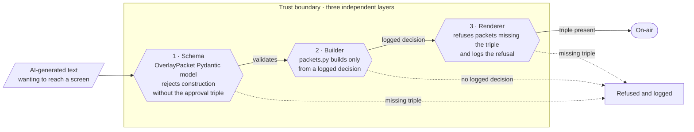

# Security

Control Room IQ is designed for the production gallery, where "the AI did it" is not an acceptable
explanation. The security posture reflects that: the trust boundary is structural, not procedural.

## The trust boundary at a glance

Three independent layers verify the same invariant — every `OverlayPacket` must carry its approval
triple (`approval_id`, `approved_by`, `approved_at`). Any text that reaches a screen without the triple
is refused at whichever layer sees it first; the gate holds even if the layers above it were bypassed.



The schema catches it at construction time (unit tests, dev, CI — the type cannot exist without the
triple). The builder catches it at build time (there is no code path that produces a packet without
looking up a logged decision). The renderer catches it at runtime (even if the first two were
bypassed). Three locks on the same door.

## Reporting a vulnerability

Report privately to the repository maintainers. Do not open public issues for security findings.
This project uses Microsoft Entra ID / managed identity only; **never commit keys, tokens or connection
strings**. See [`.env.example`](.env.example) for the checklist of values to supply via your own secrets
manager.

## Security posture — the short version

| Control | How it is implemented |
| --- | --- |
| **Mandatory human gate** | No auto-approve path exists in code. Only `decided_by = operator` approves or airs |
| **Structural approval** | `OverlayPacket` requires `approval_id`, `approved_by`, `approved_at` — the renderer refuses anything else |
| **SLA holds, never approves** | A 20 s untouched proposal becomes `held_by_sla`; the timer can hold, not fire |
| **Numbers from code only** | Agents may quote numbers but never compute them; unsourced numbers are flagged to the operator |
| **Content filters** | Variants that mention referee, betting or injury are blocked before firing |
| **No secrets in source** | Managed identity + OIDC; `.env.example` is checklist-only |
| **Supply chain scanning** | CodeQL, Trivy and Dependabot on every PR; every GitHub action pinned to a full commit SHA |
| **Full audit trail** | Append-only decision log, downloadable as `/decisions.csv`; one OpenTelemetry trace per moment, with each decision and airing linked back to it |
| **Synthetic data only** | No scraped commentary, no third-party match data, no pre-trained football models |
| **Degrade, never stall** | Offline mode runs the entire pipeline with no Azure dependency |

## 1. The approval gate

Text reaches a screen only inside an `OverlayPacket`. The packet type **cannot be instantiated** without
its approval triple:

```python
# packages/schemas/crq_schemas/__init__.py
class OverlayPacket(BaseModel):
    """What a renderer receives. Approval fields are REQUIRED: the renderer refuses packets without them."""
    ...
    approval_id: str      # the decision log entry id
    approved_by: str      # the operator's name (or `sla` for a hold — holds never air)
    approved_at: datetime
```

This is enforced at three independent layers:

1. **Schema** — Pydantic validation fails to construct the packet without these fields.
2. **Builder** — `services/api/api/packets.py` only builds packets from a logged decision; the module
   docstring is explicit: *"The packet type itself is the gate, since it cannot be constructed without
   approval fields, and these functions only ever build it from a logged decision."*
3. **Renderer** — refuses any packet missing the triple and logs the refusal.

**No settings, no feature flags, no admin override.** The gate is in the type system.

Tests: `services/api/tests/test_gate.py`, `services/api/tests/test_approval.py`.

## 2. SLA holds, never approves

If the operator does not act, the proposal is **held, never aired**. The console warns at 10 s and the
timer holds the graphic at 20; a held graphic expires once the match has moved past it. See
[`services/api/api/timing.py`](services/api/api/timing.py). The SLA actor is `sla-timer` and only ever
calls `/hold` — never `/approve`.

## 3. Content integrity

### Grounding
Every cite on an agent output must resolve to an id in the moment snapshot. See
`services/api/api/variant_checks.py`.

### Number integrity
Agents never compute. Every number on an on-air line must match or validly round a value the stats
engine produced. Numbers that cannot be resolved are listed in `OverlayProposal.unsourced_numbers` and
surfaced to the operator as an amber flag before firing.

### Variant checks (per-language)
Each AI-generated variant must pass code checks before it reaches a viewer:

- No invented numbers.
- Names exact.
- Cites within the moment.
- Length within the layer's limit.
- **No referee, betting or injury content** (English, Spanish and Hindi regexes in `variant_checks.py`).
- Actually translated (non-English variants must carry non-ASCII content; Hindi must carry Devanagari).
- Faithfulness score ≥ 0.8.

A variant that fails is replaced by a template line in the viewer's language, or the approved English
line marked as such. **A failed check never airs.**

### Override transparency
An operator override airs in English only, with an **unverified badge** on the renderer and the
viewer. The decision is audited with actor and timestamp.

## 4. Identity and secrets

- **No credentials in source.** This is a zero-tolerance rule and `.env.example` is a checklist, not a
  template to fill in.
- **Managed identity end-to-end** for data-plane access to Cosmos DB, Event Hubs, Application Insights
  and Foundry.
- **OIDC** federates GitHub Actions to Azure. CI uses `AZURE_CLIENT_ID`, `AZURE_TENANT_ID` and
  `AZURE_SUBSCRIPTION_ID` — not a password or client secret.
- **Least-privilege data-plane roles** granted per service.

## 5. Supply chain

- [`.github/workflows/codeql.yml`](.github/workflows/codeql.yml) scans Python, TypeScript and workflow
  files on every push and PR, plus weekly to catch new queries against unchanged code.
- [`.github/workflows/trivy.yml`](.github/workflows/trivy.yml) scans Python and npm dependencies,
  secrets, Dockerfiles, Bicep-compiled ARM templates and the three container images.
- [`.github/dependabot.yml`](.github/dependabot.yml) opens PRs for action and dependency updates.
- **Every GitHub action is pinned to a full commit SHA.** A tag can be moved; a SHA cannot. See the
  header comment in `.github/workflows/trivy.yml` on CVE-2026-33634 — the March 2026 incident where
  tagged versions of `trivy-action` were repointed at code that stole CI secrets. The lesson is baked
  into every workflow file in this repo.
- **Tool versions are pinned** (`TRIVY_VERSION`, `BICEP_VERSION`) rather than taking "latest."

## 6. Audit and observability

Every decision (approve, override, hold, reject, the 20 s SLA hold, expiry, supersession by a goal) is
appended to the Cosmos DB `decisions` container: written once, never updated, tagged with the replay run
it belongs to, by the API's managed identity. The write runs in the background, so a fire never waits on
it or fails because of it. `GET /decisions.csv` downloads the current run (decision id, proposal, action,
actor, time, reason, package); `GET /decisions.csv?run=all` (or `?run=<run id>`) downloads the persisted
log across runs and restarts.

One **OpenTelemetry trace per moment** (`crq.moment`) holds a `crq.agent <role>` span per agent call:
routing mode, the model the router chose (`crq.model_served`), latency, and whether the call failed and why.
The moment's span lists every template fallback with its reason (`crq.failure_reasons`). Inside each agent
span, Agent Framework's own GenAI spans record tokens in and out and the request.
Each decision (`crq.decision`: action, actor, seconds on the desk) and each airing (`crq.air`: what every
viewer group got, and why not its own version) is a span linked back to the moment's trace; an operator's
decision and its airing sit inside their fire, hold or override request. Read-only polls aren't traced.
With trace content off, failure reasons keep the error's type but not its message, which can quote a reply. Traces go to
Application Insights, which is connected to the Foundry project (Observability > Traces), with Entra ID
only. On the demo, spans also carry the prompt and response text (`CRQ_TRACE_CONTENT`), because all match
data is synthetic; a deployment with real viewer data turns that off.

Operational metrics at `GET /metrics`: turnaround, error rate, operator workload.

## 7. Data

- **Synthetic only.** All match data is generated by `services/simulator` from fictional clubs
  (`data/clubs.json`) and scripted storylines; no real Premier League match data is used or
  redistributed.
- **Deterministic.** The same seed always produces a byte-identical file; a test fails if a committed
  file drifts from what its seed generates.
- **Clean room.** No scraped commentary, no pre-trained football models, no code from any company
  product. See the README "Clean room" section.

## 8. Degradation

- **Offline mode as a first-class path.** `CRQ_OFFLINE=1` runs every service with template outputs; the
  demo survives model quota failure or an Azure outage without changing the operator's visible path.
- **Per-agent timeout** (`AGENT_TIMEOUT_S`, default 12 s) and a deterministic template fallback mean no
  agent can stall the pipeline. Fallback reasons are recorded on the `EvaluationRecord`.
- **Local adapters** behind identical repository and event interfaces mean Cosmos or Event Hubs can be
  swapped for in-process alternatives during development.

## 9. Deployment posture

The deployed demo is a public, judge-accessible proof of concept, provisioned to a dedicated
POC-tagged resource group. The network posture reflects that scope. The application-layer controls
described above (sections 1–8) run identically regardless of the deployment posture — they are
structural, not perimeter-based.

### What the deployed environment enforces

- **No local-auth credentials anywhere.** `disableLocalAuth: true` on Cosmos DB, Event Hubs and
  Application Insights;
  `allowSharedKeyAccess: false` on Storage; `adminUserEnabled: false` on ACR. There is no SAS key,
  account key, or admin password to leak. Every data-plane call requires an Entra ID principal with the
  matching RBAC role, held by the workload managed identity.
- **The API is not internet-reachable.** The API container app runs with `ingress.external: false`
  inside the Container Apps environment; the nginx web container is the single public ingress and
  proxies specific paths. The ingest container has no ingress at all.
- **Storage hardened to Trivy's floor.** Infrastructure encryption required (AZU-0061), 7-day delete
  retention on blobs and containers (AZU-0056), diagnostic settings forward every read, write and delete
  to Log Analytics (AZU-0057).
- **TLS 1.2 minimum** on Cosmos, Event Hubs and Storage.
- **Synthetic data only.** The system has no PII, no customer data, and no real match data to
  exfiltrate.
- **Full observability.** Application Insights carries one OpenTelemetry trace per moment, also shown
  in Foundry's Traces view; blob
  operations and container app logs land in Log Analytics.

### What is deferred to production hardening

For an enterprise production deployment, the following would be required and are intentionally **not**
present in this POC:

- **Private endpoints** on Cosmos DB, Event Hubs and Storage, with `publicNetworkAccess: 'Disabled'` on
  each.
- **VNet integration** on the Container Apps managed environment.
- **Azure Front Door + WAF** in front of the public web ingress.
- **IP allowlist** on data services during provisioning.
- **Foundry public access disabled**; access via private endpoint only (`publicNetworkAccess` is
  currently `Enabled` in `infra/modules/ai.bicep`).
- **Entra ID sign-in** on the operator and viewer apps (the stated next step; see Known limits).

The intended production topology is in [`docs/END-TO-END-ARCHITECTURE.md`](docs/END-TO-END-ARCHITECTURE.md)
§9. The gap between the POC and production is a configuration delta on the same Bicep modules, not a
rewrite.

## Known limits

Honesty on scope is part of the posture. See [README §Limits](README.md#limits) — notably:

- No sign-in or roles yet; anyone who can reach the API can fire a graphic. Entra ID roles are the
  stated next step and depend on the producer-takeover feature.
- Spanish and Hindi templates and labels still need a native-speaker review pass.
- Operator name is free text until Entra ID lands.
