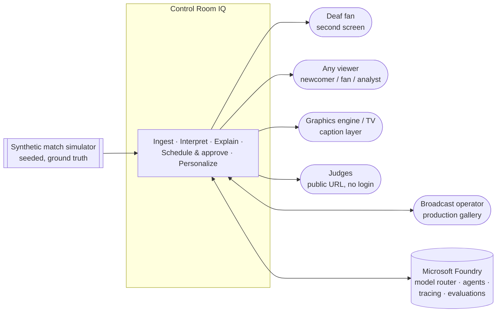
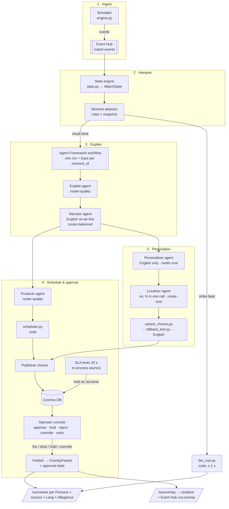
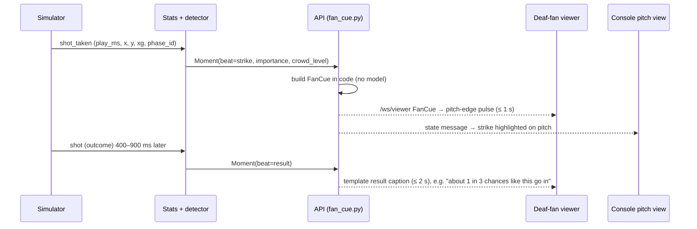
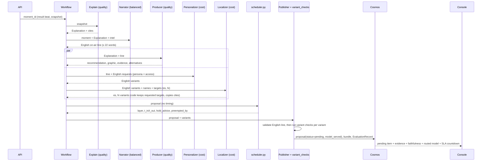
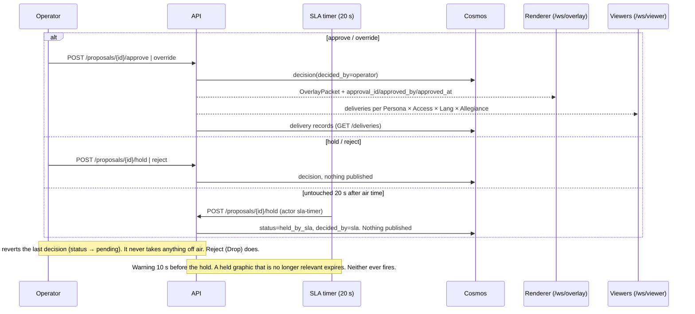
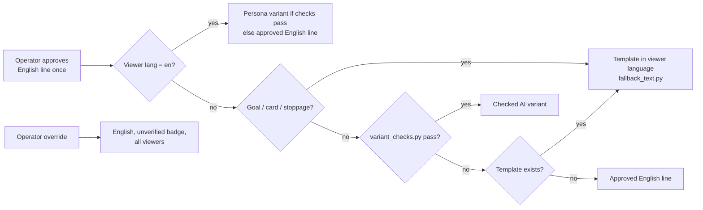
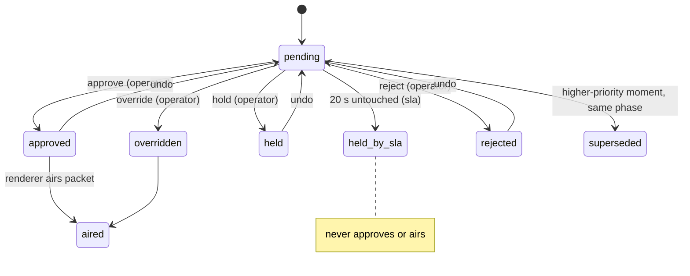
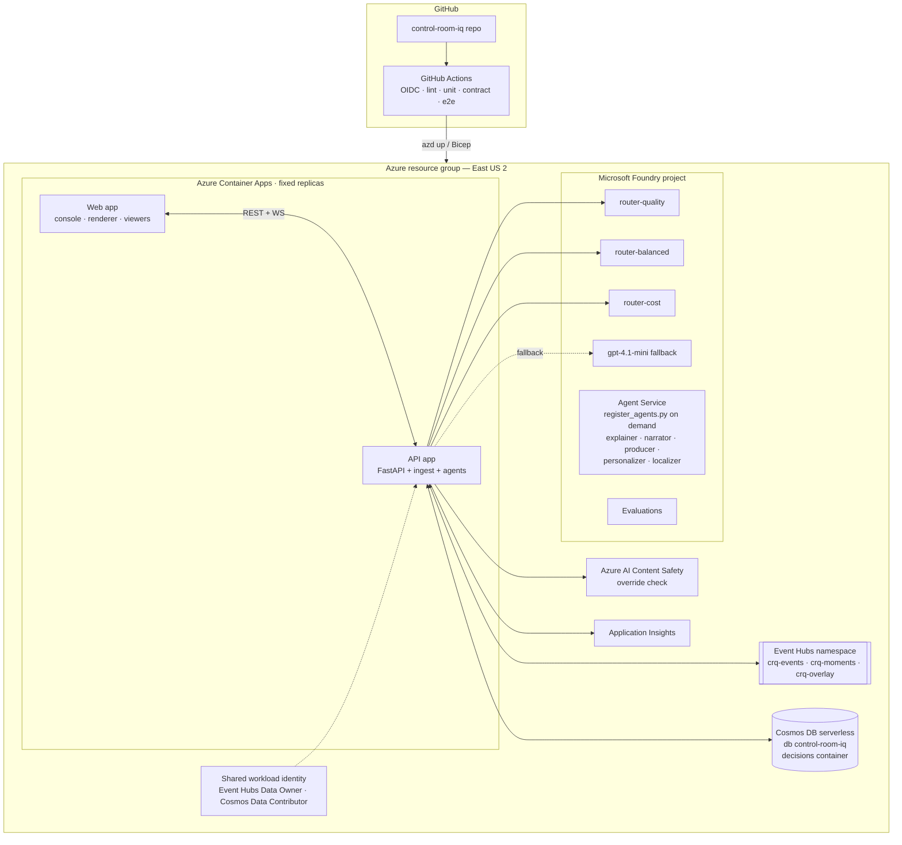

# Control Room IQ — Architecture

**Owner:** Swami · **Baseline:** `main` as of the submission (schemas v0.2, API v0.2, pipeline v0.2,
goal routine, metrics, hold warning and expiry, preview before firing, match intelligence, caption card
in code, Localizer, scheduler, Content Safety, decision persistence to Cosmos). If this document and the
repo disagree, `packages/schemas` v0.2 governs. Raise the difference rather than working around it.
**Related:** [ENTERPRISE-OVERVIEW.md](ENTERPRISE-OVERVIEW.md) (judge-facing enterprise claim),
[DESIGN.md](DESIGN.md) §5 (agent table), [THREAT-MODEL.md](THREAT-MODEL.md),
[RUNBOOK.md](RUNBOOK.md), [GALLERY-TERMS.md](GALLERY-TERMS.md), [adr/](adr/) (decision records).

> **v1.1 agent decision (Oct 24): five agents**, registered by these names: `explainer` (router-quality), `narrator` (router-balanced), `producer` (router-quality), `personalizer` (router-cost, English only) and `localizer` (router-cost, Spanish and Hindi in one call). The Narrator writes the one English line the graphics operator fires and the half- and full-time recaps. There is **no separate Recap agent**: `GET /recap` is code. The squad-author prompt is removed.

> Diagrams use Mermaid. They render on GitHub and in most Markdown viewers. If yours shows code instead, paste the block into mermaid.live.

---

## 1. Purpose and scope

Control Room IQ is "the AI member of the production gallery." It takes a live stream of **synthetic** football events and:

1. turns them into match state
2. detects moments that matter
3. explains them
4. proposes and **schedules** on-screen graphics
5. routes every proposal through a **mandatory human operator**
6. delivers the approved moment per viewer. The **deaf fan** is served first and live, in EN, ES or HI.

**In scope:** simulator → state → moments → agents → scheduler → operator gate → overlay feed → per-viewer delivery, plus evaluation, tracing, audit and the Azure deployment.

**Out of scope:** real match data, video auto-eventing, Speech and audio description, Arabic and RTL, a heat map, what-if, player cam, voice, and production broadcast integration.

---

## 2. Architecture principles

| # | Principle | What it means in the system |
| --- | --- | --- |
| P1 | **Numbers from code, words from models** | The stats engine computes xG, score, speed, distance and timing. Agents only explain, narrate, select, personalize and localize. A number on the English line that is not in the moment's facts is flagged to the graphics operator (`unsourced_numbers`) |
| P2 | **Scheduling is code, content is AI** | The Narrator writes the English line and the Producer proposes the graphic. `scheduler.py` assigns layer, timing and collisions |
| P3 | **Cues are code, captions are AI** | `FanCue` (strike beat) is built in plain code with no model call. Captions come later |
| P4 | **The gate is structural, not procedural** | Text reaches a screen only inside an `OverlayPacket` carrying `approval_id / approved_by / approved_at`. The renderer refuses anything else. No auto-approve path exists |
| P5 | **The SLA holds, never approves** | A proposal left untouched for 20 s becomes `held_by_sla`, with a warning 10 s before; a held graphic that is no longer relevant expires. No timer, default or AI ever fires a graphic |
| P6 | **Model choice is visible** | Three model-router deployments. The routed model is recorded on every span and shown on the proposal |
| P7 | **Degrade, never stall** | Every agent has a timeout and a template fallback. Offline mode runs the entire pipeline with no Azure |
| P8 | **Schedule on play time** | Timing uses monotonic `play_ms`. `{period, clock_ms}` is for display only |
| P9 | **Clean room** | Synthetic data only. No scraped commentary, no pre-trained football models, no copied third-party code |
| P10 | **Cloud services are adapters** | The domain flow works offline first. Azure services wrap it without changing contracts |

---

## 3. System context



---

## 4. Logical architecture: the five stages



### 4.1 Component catalog

| Component | Type | Owner | Responsibility |
| --- | --- | --- | --- |
| **Simulator** (`services/simulator/engine.py`, `cli.py`) | Python, deterministic, seedable | Pranav | Emits passes, carries, shots (`shot_taken` 400–900 ms before `shot`), tackles, pressure, stoppages, whistles, cards, subs and crowd events, with `play_ms`, `phase_id`, `x, y, end_x, end_y` on a 0–100 pitch. Its hidden ground truth is what evaluations score against |
| **Stats engine** (`services/ingest/stats.py`) | Code | Pranav | Builds `MatchState`: score, xG, PPDA, `xg_last_5min`, `shots_last_5min`, `pressure_trend` (3-min window), `momentum_label`, `zone(x,y)`, `last_stoppage`, `current_phase` + position trail, `shots` ledger with `chance_rank`, `recap_points` (importance ≥ 0.6) |
| **Moment detector** | Code (rules) | Pranav | Raises moments with a bounded snapshot. A big chance is two beats: `strike` on `shot_taken` and `result` on `shot` |
| **FanCue builder** (`services/api/fan_cue.py`) | Code, no model | Swami | Team, attack direction (home left→right in the first half, swapped after), zone, pulse `tap/pulse/wave/surge` from importance, crowd level |
| **Workflow** (`services/agents/agents/workflow.py`) | Agent Framework graph | Siranjeevi | Per result-beat moment: Explain → Narrator, then Producer ∥ (Personalizer → Localizer), then the scheduler. One trace per `moment_id`. Per-node timeouts and template fallbacks |
| **Explain agent** (`explainer`) | LLM via `router-quality` | Siranjeevi | `why_it_matters`, past / now / next, `control_vs_chaos`, `cites[]` |
| **Narrator agent** (`narrator`) | LLM via `router-balanced` | Siranjeevi | The English on-air line (≤ 22 words) the graphics operator fires, which every other version is checked against; the half- and full-time recap |
| **Producer agent** (`producer`) | LLM via `router-quality` | Siranjeevi | Recommendation, graphic, evidence lines, alternatives. **No timing**. `payload.intel` is overwritten by code after it runs |
| **Scheduler** (`services/agents/scheduler.py`) | Pure Python, unit-tested | Siranjeevi | Layer, `t_in/t_out` (play-ms), collisions, preemption, SLA, hold advice (rules in §6.3) |
| **Personalizer agent** (`personalizer`) | LLM via `router-cost` | Siranjeevi | English only: one version per persona (newcomer, fan, analyst) × access (none, deaf) that was asked for. The deaf fan's `FanCard` is built in code (`api/fan_card.py`), not by an agent |
| **Localizer agent** (`localizer`) | LLM via `router-cost` | Siranjeevi | Renders the checked English versions in es and hi in one call; numbers, units and names unchanged. Code keeps only the requested targets, copies the English cites and drops anything labeled English (`keep_localized`). Offline or on failure: the template line in that language, never English labeled as es/hi |
| **Recap** (`GET /recap`) | Code | Swami | "What did I miss" (10/20/30 min) from `recap_points` and the shot ledger. Not an agent; the Narrator writes the half- and full-time recap text |
| **Publisher + variant checks** (`variant_checks.py`, `fallback_text.py`) | Code | Swami | Validates schema, cites, numbers, names and length. Decides variant → template → English per viewer group |
| **API** (`services/api`) | FastAPI | Swami | REST + WebSockets, decisions, deliveries, recap, schedule, metrics, CSV export, SLA hold with warning and expiry (`timing.py`), goal routine (`goal_package.py`), preview before firing (`preview.py`), deaf fan's caption card (`fan_card.py`) |
| **Operator console** (`web/`) | React + TypeScript | Mudassar | Program feed with the top-down pitch, scheduler timeline, proposal card (evidence, faithfulness, routed model, hold advice, SLA countdown), decision buttons, deliveries chips, decision log |
| **Renderer** (`web/`) | React + TypeScript | Mudassar | Holds the clock, upserts by `cue_id`, honors `replaces[]`, **refuses packets without the approval triple**, shows the unverified badge, Devanagari font |
| **Viewer apps** (`web/`) | React + TypeScript | Mudassar | Viewer picker (persona / access / lang / allegiance), deaf-fan two-beat UI, pitch-edge pulse, catch-up card, TV caption layer |
| **Evaluation** (`evals/run_eval.py`) | Python + Foundry Evaluation | Siranjeevi | Replays the reference match, runs Foundry evaluators, counts planted falsehoods caught, writes `evals/results/latest.md` |

---

## 5. Runtime flows

### 5.1 Strike beat (code only, ≤ 1 s)



### 5.2 Result beat (agents; event to console ≤ 12 s, worst case about 20 s)



### 5.3 Decision and publication



### 5.4 Hero flow: supersession and preemption

At about 41', a big-chance proposal is pending. A **goal** on the same `phase_id` arrives 1.4 s later.

1. The chance proposal becomes `superseded`. The console shows "held, goal followed" with the hold button highlighted. **Supersession** is a priority table over pending proposals. *As built (#60): the goal supersedes every pending card of its move. The decision log records it as `expired` with actor `supersession`; there is no separate `superseded` status yet. A card from that move whose agents finish after the goal is never queued.*
2. The goal proposal becomes the active decision, with `hold_advice` explaining the hold.
3. On approval, the goal card **preempts** the running lower third. The scheduler re-sends the displaced cue under the same `cue_id` with a shortened duration and `preempted_by`.
4. The renderer airs the goal card. The deaf fan, who saw the strike pulse 1.4 s earlier, gets the caption and detail in their language.

Neither step involves agents negotiating; both are code rules.

### 5.5 Goal routine, metrics, timing and preview (on `main`)

- **Goal routine** (`api/goal_package.py`, #8): one click (**Fire all 3**, `POST /packages/{id}/approve`) fires a sequenced package: goal graphic → scorer stats after the replay → ticker. Follow-ups are computed in code; each item can be dropped.
- **Gallery words** (`docs/GALLERY-TERMS.md`): Running order, Fire, Drop, Graphics operator, Goal routine.
- **Metrics** (`api/metrics.py`): `GET /metrics` reports turnaround, error rate and operator workload.
- **Hold warning and expiry** (`api/timing.py`): `warn_at` 10 s before the 20 s auto-hold; stale held graphics expire. Neither ever fires.
- **Preview before firing** (`api/preview.py`, #18): the graphics operator picks viewer groups (`GET /viewer-groups`) and sees, per group, exactly what would air and why (`GET /proposals/{id}/preview`), including a typed override. Nothing is sent.
- **Caption card** (`api/fan_card.py`, #23): one card for the deaf fan, facts filled in code; the caption is the packet's line.
- **Producer takeover** is the stated next step, not built: "if the graphics operator is away, the producer's console takes over; the AI never does." 

### 5.6 Match intelligence (expectation ii)

The stats engine rates every pass (distance, difficulty 0–1 with a label, passer accuracy, ball speed), records shot speed, counts sprints and distance, and raises `ThresholdIndicator`s (proposed: top speed ≥ 32 km/h, distance 5/10 km, pass difficulty ≥ 0.8, pass ≥ 40 m, shot ≥ 100 km/h). It attaches the numbers for each moment as `Moment.metrics` and keeps `MatchState.last_pass` and `thresholds` for the console. It also raises a new `standout_pass` moment.

`agents/match_intel.py` turns those numbers into facts every agent receives as `intel`. After the producer runs, `payload.intel` is overwritten by code, so the numbers on a graphic are always the stats engine's. Speed moments use the **lower third** (the player tag's 40-character limit was too short) and standout passes the `stat_panel`. Variant checks allow intel numbers and nothing else; a number on the English line that is not in the facts is listed in `unsourced_numbers` and shown to the graphics operator as an amber flag. Fans get whole numbers, analysts one decimal; analyst text does not repeat a number already on the chip. The console has a Match intelligence panel; proposals, moments and the viewer overlay show chips in the viewer's register (newcomer in words, fan one number, analyst the full figures).

---

## 6. Core logic

### 6.1 Moment detection

| Moment type | Trigger | Priority (high → low) |
| --- | --- | --- |
| `goal` | goal event | 1 |
| `big_chance` | xG ≥ 0.30 or `chance_rank` ≤ 3; two beats | 2 |
| `card` | card event (incl. second yellow, VAR) | 3 |
| `stoppage` | `stoppage` + `whistle` (reason, against, restart) | 4 |
| `pressure_shift` | pressure spike ≥ 9/min; `pressure_trend` on 3-min window | 5 |
| `milestone`, `sub` | rules | 6 |
| `half_time`, `full_time` | whistle | 0 |

`importance` drives the FanCue pulse and `recap_points` (≥ 0.6). The big-chance snapshot **must** include `pressure_trend`, because hold advice reads it.

### 6.2 Viewer model and variant resolution

There are four independent axes: **Persona** (newcomer / fan / analyst) × **Access** (none / deaf) × **Lang** (en / es / hi) × **Allegiance** (home / away / neutral).



**`variant_checks.py` rules:** no invented numbers · names exact · cites within the moment · layer length limits · no referee, betting or injury talk · actually translated · faithfulness ≥ 0.8.
**Allegiance:** supporter framing ("your side") is applied by code. Facts and variants are identical across sides.
**Deaf access:** FanCue (strike) → template caption (result) → FanCard detail on the decision.

### 6.3 Scheduler rules (`scheduler.py`)

| # | Rule | When |
| --- | --- | --- |
| 1 | Per-layer collision check | Fri (P0) |
| 2 | Earliest free gap | Fri (P0) |
| 3 | One story per 30 s window | Sat (P1) |
| 4 | Goal or red card preempts `lower_third` | Fri (P0) |
| 5 | `hold_advice` when `pressure_trend == rising` and the moment is not a goal | Sat (P1). The console reserves the slot on Friday |
| 6 | 20 s SLA hold (`held_by_sla`, `decided_by = sla`) | Fri (P0) |
| — | `min_hold_ms` legibility floor; per-kind `max_delay_ms` (goal about 60 s, yellow about 15 s) with an importance exemption | Fri |

Layers (closed enum): `lower_third`, `fullscreen`, `ticker`, `stat_panel`, `player_tag`, `caption`, `pitch_overlay`. **The caption layer never queues**; a new caption always cuts the running one.

If the scheduler isn't ready, the API assigns timing by arrival and labels the block "unscheduled." The SLA still runs. Never fake a collision rule.

### 6.4 Proposal state model

Status is a **derived predicate** over `(default_status, last_decision)`, not a transition graph (D1).



**Blocking (D3, two-tier, pending confirmation):** `unsupported` text is a hard block on the server with no override; the only exits are strike or edit (edit re-verifies on Saturday). `uncertain` text needs a logged acknowledgment checkbox. The UI shows reasons, not scores.

### 6.5 Renderer transport (D2)

- The renderer holds the clock. Packets arrive ahead of airtime with `t_in/t_out` in play-ms.
- **Upsert by `cue_id`.** Preemption is a re-send with a shortened duration; a queued cue is re-sent with duration 0. There is no cancel verb.
- Late packets anchor at their arrival time. A cue already held keeps its anchor.
- A `replaces: [cue_id]` on the new cue lets a verified card take over a template's slot.
- **Guard:** reject any packet missing `approval_id`, `approved_by` or `approved_at`, and log the refusal.
- Open risk: if the renderer runs out-of-process, clock-offset sync has no prior art. Budget for it.

---

## 7. Data contracts (v0.2 summary)

| Contract | Key fields |
| --- | --- |
| **Event** | `event_id`, `match_id`, `type`, `play_ms`, `period`, `clock_ms`, `x, y, end_x, end_y` (0–100), `phase_id`, team/player ids, `xg` (shots), `assist_by`, `key_pass`, `blocker`, `crowd_level`, stoppage `reason/against/restart` |
| **Moment** | `moment_id`, `moment_type`, `beat` (strike / result / single), `play_ms`, `period`, `clock_ms`, `trigger_event_id`, `phase_id`, `stoppage_id`, `priority`, `importance`, `snapshot` |
| **Explanation** | `why_it_matters`, `past`, `now`, `next`, `control_vs_chaos`, `cites[]` |
| **OverlayProposal** | `recommendation`, `graphic`, `evidence[]`, `alternatives[]`, `cites[]`; from scheduler: `layer`, `t_in`, `t_out`, `window_id`, `hold_advice`, `preempted_by`; `status`, `decided_by`, `faithfulness`, `model_served` |
| **OverlayPacket** | `cue_id`, `match_id`, `layer`, `t_in/t_out` (play-ms), `start/end` {period, clock_ms}, `priority`, `template`, `lang`, `persona`, `access`, `headline`, `body`, `replaces[]`, `evidence[]`, `verified`, `fallback`, `min_hold_ms`, `max_delay_ms`, **`approval_id`, `approved_by`, `approved_at` (required)** |
| **FanCue** | `team`, `direction`, `zone`, `pulse`, `crowd_level`, `play_ms` (no text) |
| **FanCard** | `cue`, `pulse`, `caption` (template, ≤ 12 words), `detail` {chance_quality, text}, `context` {past, now, next}, `cites[]`, `display`, `lang`. **One card, built in code** (`api/fan_card.py`); the web translates its fixed words from a small en/es/hi table |
| **NarrativeVariant** list | One per (persona, access, lang) asked for: English from the Personalizer, es/hi from the Localizer (English cites copied by code); `checks[]` per variant |
| **RecapCard** | `headline`, `story[3–5]`, `what_must_change`, `cites[]` |
| **EvaluationRecord** | `moment_id`, `beat`, `agent`, `prompt_version`, `snapshot`, `output`, `cites_resolved/total`, `numbers_ok`, `fallback_reason`, `variant_checks`, `faithfulness`, `model_served`, `routing`, `latency_ms`, `superseded`, `expected` |

**Open contract items:** es/hi native-speaker review; whether `t_start_ms/t_end_ms` become display-only once the scheduler lands. (Decided Oct 23: one FanCard, facts in code.)

---

## 8. Interfaces

| Interface | Purpose |
| --- | --- |
| Replay control | Start and pace the seeded reference match (`play_ms` clock, period display). Offline mode uses `data/reference/match-042.jsonl` |
| `GET /proposals?status=pending` | Pending decisions, highest priority first, with evidence, faithfulness, `model_served`, `hold_advice`, SLA deadline |
| `POST /proposals/{id}/approve \| hold \| reject \| override` | Operator decision (idempotent; actor + timestamp). `hold` is also called by `sla-timer` |
| Undo | Reverts the last decision and writes an audit row |
| `GET /schedule` | Timeline: layers × play time, with booked, proposed, queued and preempted blocks |
| `GET /deliveries` | Per viewer group: checked variant, template or English |
| `GET /decisions.csv` | Full decision log, including SLA holds and rejects |
| `GET /recap?minutes=10\|20\|30` | Catch-up and half-time / full-time recaps |
| `GET /metrics` | Turnaround, error rate, operator workload |
| `POST /packages/{id}/approve` | Fire the whole goal routine |
| `GET /viewer-groups`, `GET /proposals/{id}/preview?view=…` | Preview before firing, for the viewer groups the graphics operator picks |
| `GET /healthz` | Liveness, offline/cloud mode, dependency status |
| `WS /ws/overlay` | `OverlayPacket` stream to the renderer, mirrored to the `crq-overlay` Event Hub |
| `WS /ws/viewer?persona=&access=&lang=&allegiance=` | Per-viewer channel. `persona=deaf` = fan + deaf |
| WS `state` message | `MatchState` with the `current_phase` trail and `shots` ledger for the pitch view |

---

## 9. Deployment architecture (Azure, East US 2)



| Resource | Configuration |
| --- | --- |
| **Foundry project** | Model router version 2025-11-18 as three deployments with `routing.mode` quality / balanced / cost. `gpt-4.1-mini` is reached only on fallback. No Speech |
| **Agent Service** | *Intended:* the five agents (explainer, narrator, producer, personalizer, localizer) registered by `register_agents.py` so they can be inspected in the Foundry portal. *Current:* the agents run in-process via Agent Framework; portal registration is a post-submission item |
| **Event Hubs** | `crq-events` (simulator → ingest), `crq-moments` (interpret → agents), `crq-overlay` (approved packets from `services/api/api/feed.py` → renderer). One consumer group each. Identity-based access. The ingest consumer runs with a fixed replica count and no durable checkpoint store; a separate agents-runner consuming `crq-moments` is intended but not deployed, so the pipeline currently runs in-process inside the API container |
| **Cosmos DB** (serverless) | Database `control-room-iq`. *Written now:* `decisions` (via `decision_store.py`, PR #100). *Reserved for post-submission iterations:* `moments`, `proposals`, `deliveries`, `evaluations`. Partition key `/match_id` on each |
| **Container Apps** | API and web apps. Readiness probe `/healthz`. Public judge URL with a pre-loaded replay and no login |
| **Identity and secrets** | Managed identity, no keys in the repo, GitHub Actions authenticates via OIDC (`AZURE_CLIENT_ID`, `AZURE_TENANT_ID`, `AZURE_SUBSCRIPTION_ID`) |
| **IaC** | `infra/ai.bicep` (router deployments), `infra/apps.bicep` (env vars `ROUTER_QUALITY/BALANCED/COST`), `azd up`. The SLA hold runs as an in-process timer in both environments; a Logic App for it is reserved for post-submission. Expect API-version drift on the first deploy; fix it in place |

### 9.1 Routing per agent

In code: `AGENT_ROUTING` and `deployment_for(agent)` in `services/agents/agents/config.py` (an agent with no routing mode gets `router-balanced`). Each agent has its own client for its router, and `AGENT_REASONING_EFFORT` (default `low`) is sent with every call.

| Agent | Deployment | Why |
| --- | --- | --- |
| Explain | `router-quality` | Reasoning about why a moment matters |
| Producer | `router-quality` | Editorial choice of graphic and evidence |
| Narrator | `router-balanced` | The on-air English line and the half- and full-time recap |
| Personalizer | `router-cost` | High volume, English register rewriting |
| Localizer | `router-cost` | High volume, constrained translation |

---

## 10. Observability, evaluation and audit

- **Tracing:** OpenTelemetry → Application Insights + Foundry tracing. **One trace per `moment_id`.** Span attributes: `crq.agent`, `crq.routing`, `crq.model_served`, plus latency, tokens, prompt version and fallback status. `agent.run` is wrapped to capture `response.model` into `meta.model_served`.
- **Evaluation:** `evals/run_eval.py` replays the reference match offline and runs Foundry evaluators for groundedness/faithfulness, relevance and fluency per language. It also runs the planted-falsehood catch count (`evals/datasets/reference-042.jsonl`, `planted-falsehoods.jsonl`) and writes `evals/results/latest.md` in README table format. It runs nightly. The README frames results honestly: diagnostic on one reference match, not proof.
- **Audit:** every agent run writes an `EvaluationRecord`. Every decision (including undo and SLA hold) goes to the append-only `decisions` container and is downloadable as `/decisions.csv`. Every delivery is visible on `/deliveries`.
- **Operational metrics:** `GET /metrics` reports turnaround, error rate and operator workload.

---

## 11. Reliability and degradation

| Failure | Behavior |
| --- | --- |
| Foundry or router quota unavailable | `CRQ_OFFLINE=1`: golden and template outputs, same visible path |
| Agent timeout (12 s per agent, `AGENT_TIMEOUT_S`; result-beat target ≤ 12 s, measured 15.3 s average) | Template-backed card and packet; `fallback_reason` recorded; no stall |
| Variant fails checks, or the Localizer is slow or fails | Template in that language immediately, else the English line marked English. Never English labeled as es/hi. Never delay the English line |
| Output fails validation | Log `fallback_reason`, publish the deterministic template. Unsupported content is never published |
| Scheduler not ready | Arrival-time timing labeled "unscheduled". SLA still runs |
| Cosmos or Event Hubs unavailable | Local adapters behind identical repository and event interfaces |
| Agent Framework fan-out mismatch | Temporary plain-Python orchestration behind the same interface |
| Public URL unstable | Record the video locally; keep offline testing instructions |

---

## 12. Security and enterprise controls

| Control | Implementation | Evidence |
| --- | --- | --- |
| Mandatory human gate | No auto-approve path or setting. Only `decided_by = operator` can approve or air | Negative-path test, `decisions.csv` |
| Structural gate | Approval triple required on `OverlayPacket`; renderer refuses without it | Renderer guard test with the triple removed |
| Grounding | Every cite resolves to an id in the moment snapshot | Evidence lines; validator test |
| Numerical integrity | Every number matches or validly rounds a snapshot value | Number-check tests |
| Variant integrity | English approved once; variants gated by code checks | `/deliveries` chips; per-rule tests |
| Override transparency | Airs unverified, in English, with a badge | Badge on renderer and viewer; audit row |
| Secret hygiene | Managed identity + OIDC; no secrets in the repo | `.env.example`, workflow |
| Data | Synthetic only, with fictional clubs and players | README "Synthetic data" section with calibration numbers |
| Content rules | No referee, betting or injury talk in variants | `variant_checks.py` |

---

## 13. Repository map

```
control-room-iq/
  services/
    simulator/   engine.py, cli.py                                      Pranav
    ingest/      stats.py                                               Pranav
    agents/      config.py, clients.py, workflow.py, match_intel.py, scheduler.py,
                 prompts/ (explainer, narrator, producer, personalizer,
                 localizer), register_agents.py                         Siranjeevi
    api/         routes, /ws/overlay, /ws/viewer, fan_cue.py,
                 variant_checks.py, fallback_text.py, recap, metrics,
                 timing.py, goal_package.py, preview.py, fan_card.py    Swami
  packages/schemas/crq_schemas   v0.2 contracts                         shared
  web/           console, renderer, viewer picker, deaf-fan viewer,
                 TV caption layer                                       Mudassar
  evals/         run_eval.py, datasets/, results/latest.md              Siranjeevi
  data/reference/ match-042.jsonl                                       Pranav
  infra/         ai.bicep, apps.bicep, data.bicep, core.bicep, azure.yaml  Swami
  docs/          ARCHITECTURE.md, ENTERPRISE-OVERVIEW.md, DESIGN.md, THREAT-MODEL.md,
                 RUNBOOK.md, GALLERY-TERMS.md, SETUP.md, CALIBRATION.md, adr/, img/,
                 internal/ (planning, handoffs, change log — historical)
```

### 13.1 Configuration

```
CRQ_OFFLINE=1
CRQ_REFERENCE_SEED=42
CRQ_OPERATOR_SLA_SECONDS=20
CRQ_DEFAULT_LANGUAGE=en
ROUTER_QUALITY=...   ROUTER_BALANCED=...   ROUTER_COST=...
AZURE_AI_PROJECT_ENDPOINT=...
AZURE_AI_FALLBACK_DEPLOYMENT=gpt-4.1-mini
APPLICATIONINSIGHTS_CONNECTION_STRING=...
EVENTHUB_NAMESPACE=...   EVENTHUB_NAME=match-events   EVENTHUB_OVERLAY=crq-overlay
COSMOS_ENDPOINT=...      COSMOS_DATABASE=control-room-iq
```

### 13.2 Run locally (Windows PowerShell)

```powershell
$env:CRQ_OFFLINE = "1"
python -m venv .venv; .\.venv\Scripts\Activate.ps1
pip install -e ".[dev]"
pytest -q
# start API and web per docs/SETUP.md, open the console (no login)
azd up   # cloud, after offline acceptance passes
```

---

## 14. Quality gates

- **≥ 20 tests green in CI by Monday**, covering: detector thresholds and the priority table · scheduler rules and the SLA hold · FanCue pulse and direction · each variant check and the fallback chain · v0.2 contract parsing (a packet without the triple fails) · guardrails (bad cite or number → template) · localization integrity · the gate invariant · end-to-end replay → decision → packet → deliveries · resilience to model timeouts.
- **Acceptance scenario** (offline, from a clean start, no login):

| Step | Expected result |
| --- | --- |
| Start the offline replay from the console, no login | Health shows ready; scoreboard, period and clock move; pitch view shows the current phase trail |
| Minute ~23 big chance | FanCue pulse ≤ 1 s and the strike highlighted on the pitch; template caption ≤ 2 s; pending proposal with evidence, faithfulness, routed model (or template label) and SLA countdown |
| Inspect the reasoning panel | The model the router selected is visible on the card and on the correlated agent span |
| Approve the proposal | OverlayPacket emitted with the approval triple and decided_by = operator; renderer airs the block; deaf fan receives the FanCard detail; /deliveries shows which groups got a variant and which a template |
| Switch the viewer to Newcomer · Hindi · home supporter | The same approved moment renders in Hindi as a checked variant or a template line, with supporter framing applied by code |
| Leave the next card untouched for 20 s | Card becomes held_by_sla with decided_by = sla; nothing becomes approved or aired; the hold appears in decisions.csv |
| Minute ~31 stoppage with card | Viewer explains why play stopped (template outside English); operator sees the card proposal |
| Reject a low-value proposal | Nothing airs; reject recorded with actor; undo restores pending, not air |
| Minute ~41 chance, then goal 1.4 s later | Chance proposal superseded ("held, goal followed"); goal becomes active with hold advice; goal card preempts the running lower third on the timeline |
| Override the goal line | Operator text airs unverified, in English, with the badge; decision audited |
| Half time and full time | Recap card with cites; GET /recap?minutes=20 returns the catch-up (Saturday) |
| Remove the approval triple from a packet (test tool) | Renderer refuses it and logs the refusal |
| Disable the model or quota | Templates preserve the same visible path without a stall; template labels appear on cards |
| Inspect trace and evaluation | One correlated record per moment with model_served; no unresolved cite or unsupported number aired |

If cloud mode fails, ship the offline slice and show Foundry traces and evaluation evidence only if they were produced.

---

## 15. Key architecture decisions (summary log)

Short log; the long-form records for ADR-001 to ADR-004 are in [adr/](adr/).

| ID | Decision | Rationale |
| --- | --- | --- |
| ADR-01 | Own deterministic, seedable simulator | Synthetic-only rule; ground truth for evals; repeatable demo |
| ADR-02 | Python + FastAPI + Agent Framework; React + TypeScript | Microsoft-stack learning goal; team skills |
| ADR-03 | Container Apps + Event Hubs + Cosmos serverless, Bicep/azd, East US 2 (Logic App for SLA deferred — in-process timer in both environments) | Cloud native, one-command deploy, model availability |
| ADR-04 | Model router as three deployments with per-agent routing modes; routed model on every span | Visible, auditable model choice per agent |
| ADR-05 | Mandatory, structural operator gate; SLA holds, never approves | Enterprise trust; the main differentiator |
| ADR-06 | Deterministic scheduler in code, not an agent | Testable, explainable timing |
| ADR-07 | Schedule on `play_ms`, display the match clock | The match clock stops and 45+3 sorts wrong |
| ADR-08 | Renderer holds the clock; upsert by `cue_id`; no cancel verb | Survives jitter and reconnects; protects the 2 s deaf-fan target |
| ADR-09 | FanCue in code; captions after the decision | Strike cue ≤ 1 s with no model risk |
| ADR-10 | Operator approves English once; variants gated by code checks | One decision per moment while still serving 3 personas × 3 languages |
| ADR-11 | Four-axis viewer model (Persona × Access × Lang × Allegiance) | Accessibility is a delivery rule on any persona, not a persona of its own |
| ADR-12 | EN/ES/HI only; no Speech or audio description | Focus on the deaf fan and three languages done well |
| ADR-13 | Offline mode as a first-class path | The demo must survive quota or cloud failure |
| ADR-14 | Goal routine as a one-click sequenced package; follow-ups computed in code | Feedback from a control-room operations lead (Oct 23) |
| ADR-15 | No AI or default decision when the operator does not act: warn, hold, expire | The gate stays human; the producer's console taking over is the stated next step |
| ADR-16 | One caption card for the deaf fan, facts filled in code | One contract; no extra model call; translations of fixed words in the web |
| ADR-17 | Five agents: explainer, narrator, producer, personalizer (English), localizer (es + hi); no Recap agent | The Narrator's English line is what the operator fires and what everything is checked against; Spanish and Hindi are a constrained translation, not a second creative pass |

---

## 16. Open architecture questions

1. D3 two-tier blocking: confirm.
2. `t_start_ms/t_end_ms` as display-only after the scheduler lands.
3. Renderer out-of-process → clock sync design.
4. Model-router quota in the sandbox subscription; first `azd up` API-version drift.
5. es/hi native-speaker review of templates and of Localizer output on the reference match.
