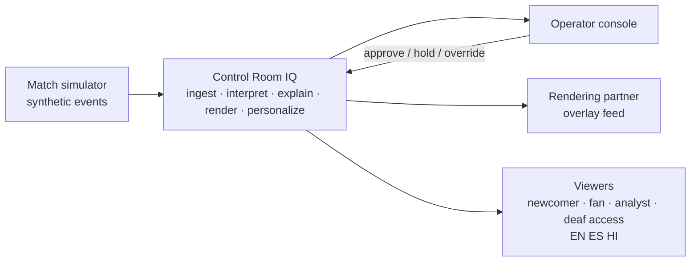
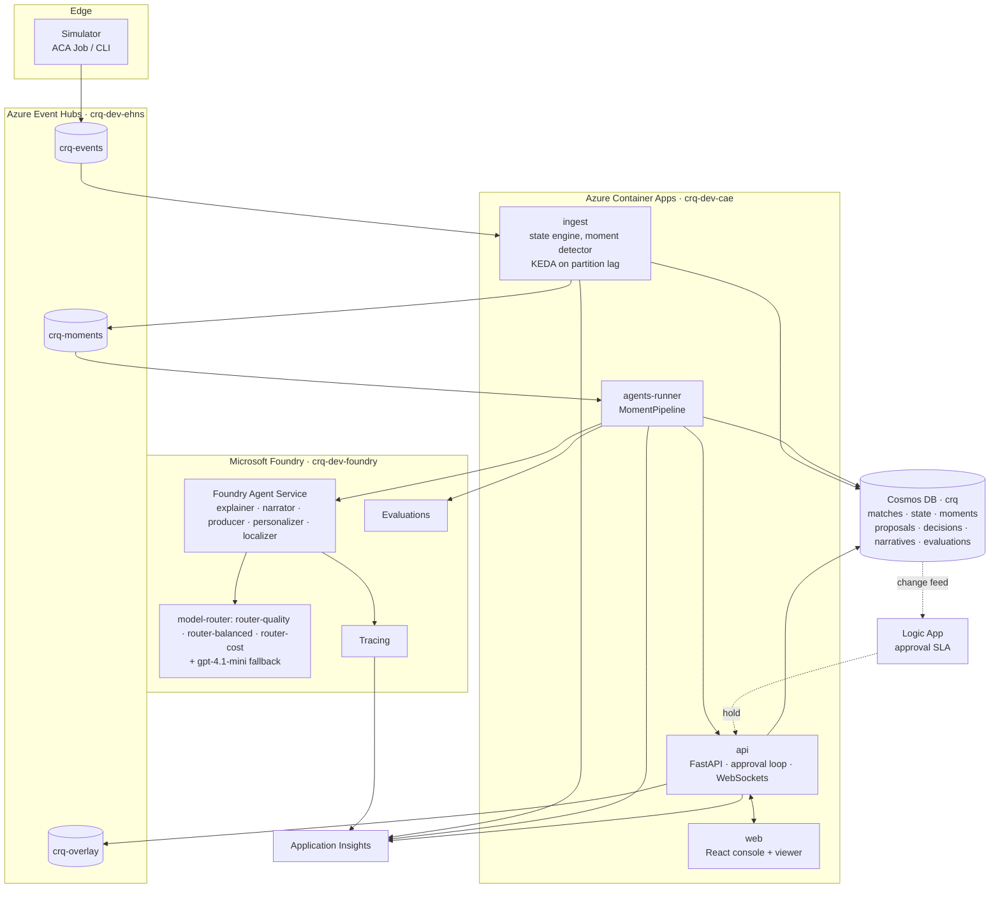
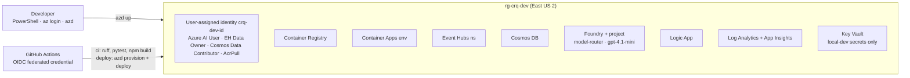

# Control Room IQ — Architecture

Version 0.2 · October 20, 2026 · Region: East US 2 · Companion to [DESIGN.md](DESIGN.md) and
[SOLUTION.md](SOLUTION.md).

## 1. Context



Inputs are synthetic match events. Outputs are an operator
console, a timed machine-readable overlay feed, and personalized viewer streams. The only human in the
loop is the operator; nothing airs without an operator action or an explicit SLA rule.

## 2. Containers



| Container | Runtime | Responsibility | Scales on |
| --- | --- | --- | --- |
| simulator | ACA Job (or local CLI) | Generate and replay matches; publish to `crq-events` | Manual / per match |
| ingest | Container App, Python | Consume events, fold state, raise moments, persist, publish to `crq-moments` | Event Hubs unprocessed events (KEDA, threshold 64) |
| agents-runner | Container App, Python | Consume moments, run `MomentPipeline` (five agents) on Foundry, call evaluation, hand results to API | Event Hubs lag on `crq-moments` |
| api | Container App, Python (FastAPI) | Proposal queue, approval loop, decision log, WebSocket fan-out, overlay publishing | HTTP concurrency (1–3 replicas) |
| web | Container App, nginx | Static React app | 1–2 replicas |

For the hackathon the agents-runner is folded into the api process (local replay mode) so the demo has
fewer moving parts; the Bicep already provisions it as a separate app for the Azure path.

## 3. Runtime: one moment, end to end

```mermaid
sequenceDiagram
    autonumber
    participant S as Simulator
    participant EH as Event Hubs
    participant I as ingest
    participant C as Cosmos DB
    participant A as agents-runner
    participant F as Foundry (agents, router, eval)
    participant P as api
    participant O as Operator console
    participant V as Viewer
    S->>EH: MatchEvent (shot, xG 0.38, saved)
    EH->>I: event
    I->>I: fold state; detect big_chance (importance 0.73)
    I->>C: state snapshot, Moment
    I->>EH: Moment → crq-moments
    EH->>A: Moment
    A->>F: explainer (Quality route)
    F-->>A: Explanation + cites
    A->>F: narrator (Balanced)
    F-->>A: line
    par
        A->>F: personalizer (Cost) → 6 English variants
        A->>F: localizer (Cost) → 12 Spanish and Hindi variants
    and
        A->>F: producer (Quality) → OverlayProposal
    and
        A->>F: evaluation (faithfulness)
    end
    A->>C: narratives, proposal, evaluation
    A->>P: MomentResult
    P-->>O: proposal + reasoning + score (WebSocket)
    O->>P: POST /proposals/{id}/override {line}
    P->>C: DecisionLogEntry
    P->>EH: OverlayItem → crq-overlay
    P-->>V: overlay (variant for persona, lang)
```

Latency budget from event to proposal on the console: ingest < 200 ms, explainer ≤ 4 s, narrator ≤ 2 s,
(personalizer → localizer) ∥ producer ≤ 6 s, total ≤ 12 s; the 8-second agent timeout plus fallbacks caps the worst
case at about 20 s (the localizer is a second call after the personalizer). Overlay timing uses the match clock, so proposal latency shifts when a graphic is
proposed, not when it is scheduled to air.

## 4. Data

### 4.1 Stores

| Store | Content | Partition | Retention |
| --- | --- | --- | --- |
| Event Hubs `crq-events` (8 partitions) | Raw `MatchEvent` | `match_id` | 1 day |
| Event Hubs `crq-moments` (4) | `Moment` with state snapshot | `match_id` | 1 day |
| Event Hubs `crq-overlay` (4) | `OverlayItem` (approved) | `match_id` | 1 day |
| Cosmos DB `crq` (serverless) | `matches`, `state` (every 25 events), `moments`, `proposals`, `decisions`, `narratives`, `evaluations` | `/match_id` | Sandbox lifetime |
| Storage `crqdevst` | Generated match files, evaluation datasets | — | Sandbox lifetime |

### 4.2 Contracts

Pydantic models in `packages/schemas` (see DESIGN.md §2). Overlay `payload` per layer:

| Layer | Payload |
| --- | --- |
| `lower_third` | `{ "label": str, "values": [[name, value], ...≤2] }` |
| `stat_panel` | `{ "title": str, "rows": [[label, home, away], ...≤5] }` |
| `heatmap` | `{ "team": id, "window_min": [from, to], "cells": [[x, y, weight], ...] }` |
| `ticker` | `{ "text": str }` |
| `full_screen` | `{ "score": [h, a], "xg": [h, a], "possession": [h, a], "momentum": [...], "headline": str }` |

## 5. Microsoft Foundry usage

| Capability | Where | Notes |
| --- | --- | --- |
| Agent Framework (`agent-framework` ≥ 1.22, `agent-framework-foundry`) | `services/agents` | `Agent` per role; sequential and concurrent composition in `workflow.py`; structured outputs via `response_format` |
| Foundry Agent Service | Foundry project `crq` | Agents registered by name for portal inspection, evaluation, and tracing |
| Model router (`model-router`, 2025-11-18) | All agent calls | Routing mode per agent via request metadata; selected model recorded in spans |
| Fixed fallback deployment (`gpt-4.1-mini`) | `MODEL_FALLBACK_DEPLOYMENT` | Used when the router returns an error or exceeds timeout budget |
| Evaluations (`azure-ai-projects` ≥ 2.3) | `evals/`, agents-runner | Groundedness/faithfulness, relevance, fluency per language, content safety |
| Tracing | All services | OpenTelemetry via Agent Framework instrumentation → Application Insights |
| Content safety | Foundry resource | Applied to all generated text |

## 6. Deployment



`infra/main.bicep` (subscription scope) creates the resource group and four modules: `core`
(identity, logs, App Insights, ACR, storage), `data` (Event Hubs, Cosmos with RBAC), `ai` (Foundry
resource, project, the three model-router deployments and the fallback, role assignments), `apps` (Container Apps environment and
the three apps with KEDA rules). `azure.yaml` maps the services to Dockerfiles so `azd deploy` builds and
pushes images and sets the image on each app. GitHub Actions `deploy.yml` runs the same two commands on
push to `main` using an OIDC federated credential; no secrets are stored.

Environments: `dev` (sandbox, the demo) only. Naming `crq-<env>-<resource>`, tags `project`, `owner`,
`expires=2026-11-30`.

## 7. Non-functional requirements

| Quality | Target | How |
| --- | --- | --- |
| Responsiveness | Proposal on console ≤ 10 s after the event; overlay timing exact on the match clock | Async pipeline, concurrent agents, 8 s timeouts, match-clock scheduling |
| Resilience | Feed continues through any single agent or model failure | Template fallbacks, failure log, KEDA scaling, checkpointed consumers |
| Explainability | Every line traceable to events; faithfulness measured | Cited event IDs, state snapshots per moment, Foundry evaluation per narrative |
| Control | No graphic airs without operator action or an explicit SLA rule | Approval state machine, append-only decision log, Logic App auto-hold |
| Security | No keys; least privilege | Managed identity, Entra-only data planes, five scoped role assignments |
| Observability | Every moment and decision visible end to end | OpenTelemetry spans (service → agent → model), App Insights, health endpoints |
| Portability | Any rendering partner or viewer client can consume the output | Overlay contract on Event Hubs and WebSocket; JSON schemas versioned |
| Cost | Under $300 for the build week at demo volumes | Serverless Cosmos, 1 TU Event Hubs, consumption Container Apps, Cost routing for the personalizer |

## 8. Scaling notes

One match stays on one Event Hubs partition, so ordering is preserved per match and multiple matches
scale across partitions. The state engine holds one `StateFolder` per match in memory and checkpoints a
snapshot every 25 events to Cosmos, so a replacement replica can resume from the last snapshot plus the
Event Hubs checkpoint. Personalization scales with viewers at zero model cost because variants are
produced per moment, not per viewer. The producer is the only agent that needs global state (what is on
air), and it reads it from the API's queue rather than holding its own.

## 9. Local development

Everything runs with no Azure: `CRQ_OFFLINE=1` makes every agent use its fallback, the API replays a
match file in-process, and the console connects to `localhost:8000`. The same code paths run in Azure
with the environment from `azd env get-values`. See [SETUP.md](SETUP.md).

## 10. Decisions

[ADR-001](adr/ADR-001-python-agent-framework.md) Python + Agent Framework ·
[ADR-002](adr/ADR-002-synthetic-data.md) own simulator (LLM squad authoring cut on Oct 22) ·
[ADR-003](adr/ADR-003-model-router.md) model router over fixed deployments ·
[ADR-004](adr/ADR-004-container-apps.md) Container Apps over AKS.
