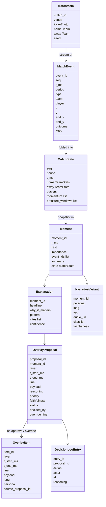
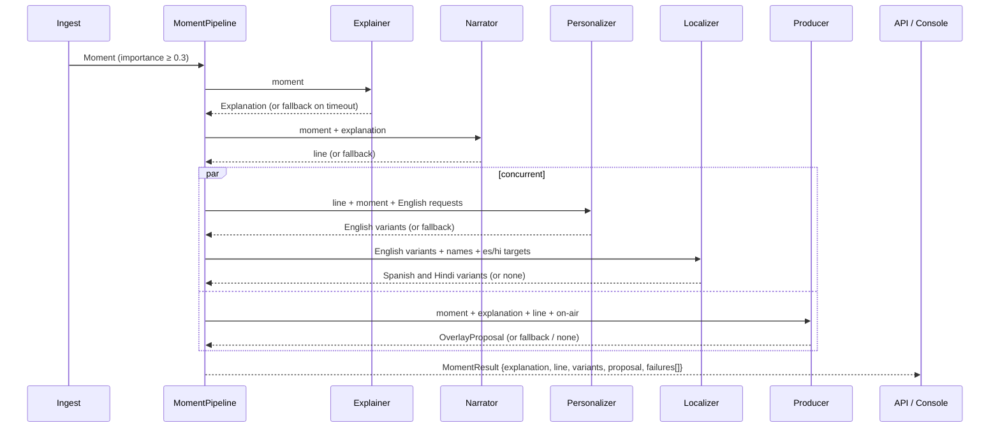
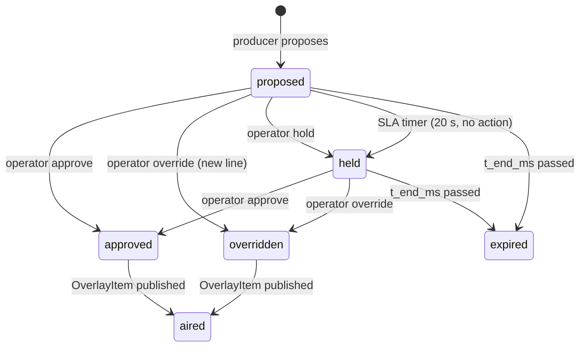

# Control Room IQ — Design

Companion to [ARCHITECTURE.md](ARCHITECTURE.md) (structure and infrastructure) and
[ENTERPRISE-OVERVIEW.md](ENTERPRISE-OVERVIEW.md) (what and why, judge-facing). This document covers how
each part behaves: data contracts, the state engine, the agents and their orchestration, the approval
loop, the overlay feed, personalization, evaluation, failure handling, and the user interfaces.

## 1. Design principles

1. **Ground truth is deterministic.** Everything the agents say is judged against state computed by
   plain code from the event stream. The simulator is seedable so any run can be reproduced.
2. **Propose, never publish.** Agents produce proposals; only an operator action (or an explicit SLA
   rule) changes what airs. The producer agent cannot write to the overlay feed.
3. **The feed never stalls.** Every agent call has a timeout and a template fallback. A degraded line is
   better than a blank screen; the degradation is visible and logged.
4. **One vocabulary.** All services exchange the Pydantic models in `packages/schemas`. The TypeScript
   front end mirrors them. No service invents fields.
5. **Cite or stay quiet.** Explanations and narratives carry the event IDs they rely on, which is what
   makes faithfulness measurable.
6. **Identity, not keys.** Managed identity in Azure, `az login` locally. No connection strings in code.

## 2. Data contracts

Defined once in `packages/schemas/crq_schemas/__init__.py` (version `0.1.0`). Summary of the ones that
cross service boundaries:

Conventions: pitch coordinates are 0–100 on both axes, attacking left to right for the team in
possession; `t_ms` is the match clock from the start of the period, so timing on overlays is independent
of wall-clock replay speed; `attrs` carries type-specific fields (pass `distance_m`, `difficulty`,
`progressive`, `ball_speed_kmh`; shot `xg`, `speed_kmh`, `body`; carry `distance_m`, `speed_kmh`;
pressure `intensity`, `target`).

## 3. Synthetic data

### 3.1 Match engine (`services/simulator/engine.py`)

A possession-phase model. Each phase is a sequence of actions by the team in possession that ends in a
shot, a turnover (interception, tackle after pressure), or a foul. Per action the engine chooses shoot,
carry, or pass from the ball position and the player's ratings; pass success is a function of distance,
direction, zone, and the passer's rating; shot outcome is drawn against an xG computed from distance and
angle to goal. Pressure events are raised on the carrier with a probability set by the opponent's style
(`press` > `counter` > `direct` > `possession`). Time advances per action from distance and speed, so a
match runs about 90–95 minutes of clock.

Calibration (10 seeds): 1,050–1,200 passes, 19–34 shots, 1.4–3.7 xG, 0–4 goals, 440–500 pressure events,
26–39 fouls per match. These are in the range of a professional match, which is what "football-realistic"
needs to mean for the statistics and narratives to feel right. Tunable constants are at the top of the
file and covered by `tests/test_engine.py`.

### 3.2 Squads (`squads.py`)

Deterministic fictional clubs, names, and ratings; the reference matches use the hand-written clubs in
`data/clubs.json`. (The LLM squad-authoring agent was cut on Oct 22; its prompt was removed on Oct 24.)

### 3.3 Replay

`simulator.cli replay` streams a match file at 1×–100× to stdout or to Event Hubs (partition key =
`match_id`, so one match stays ordered on one partition). The API's `/matches/replay` runs the same
loop in-process for local demos.

## 4. State engine (`services/ingest/stats.py`)

`StateFolder.apply(event) -> list[Moment]` is a pure fold: no I/O, same code in tests, in the Event Hubs
consumer, and in the API's local replay.

| Statistic | Method |
| --- | --- |
| Possession % | Clock time between consecutive possession-bearing events, attributed to the team in possession |
| Pass completion, shots, shots on target, goals, xG | Counted from events; xG summed from shot `attrs` |
| PPDA | Opponent passes ÷ (0.25 × pressures + tackles) |
| Player distance and top speed | From carry `attrs`; `SPEED_THRESHOLD_KMH = 32` raises a moment |
| Momentum | Weighted recent actions (progressive pass 0.15, shot 0.5 + xG, tackle 0.1) with linear decay over 3 minutes, signed +home/−away, sampled per minute |
| Pressure windows | Pressure events per minute; `PRESSURE_SPIKE_PER_MIN = 9` raises a moment |

Moment kinds and importance: goal 1.0; big chance 0.6 + xG/3 (xG ≥ 0.30); momentum shift 0.55 (Δ ≥ 0.6
in a minute); pressure spike 0.5; card 0.45; speed threshold 0.35; milestone 0.3 (50 and 100 passes);
half end 0.8; match end 1.0. Each moment carries a deep copy of the state at that instant so agents see
exactly what the operator will see.

## 5. Agents (`services/agents`)

### 5.1 Roles

Five agents, each bound to one model-router deployment (`agents/config.py`, `AGENT_ROUTING`). The same
agents are also registered in the Foundry Agent Service via `python -m agents.register_agents` so each
one is visible in the Foundry portal with its routing mode and instructions. The script is idempotent;
unchanged agents are skipped, changed ones get a new version.

| Agent | Input | Output | Router deployment | Prompt |
| --- | --- | --- | --- | --- |
| Explainer | Moment (with state) + `intel` | `Explanation` (why it matters, cites) | `router-quality` | `prompts/explainer.md` |
| Narrator | Moment + Explanation + `intel` | The English on-air line (≤ 22 words), or a 4-sentence recap at half/full time | `router-balanced` | `prompts/narrator.md` |
| Producer | Moment + Explanation + line + what is on air | `OverlayProposal` (graphic, evidence, alternatives; no timing) or nothing | `router-quality` | `prompts/producer.md` |
| Personalizer | line + Moment + `intel` + requests (persona, access, focus) | English `NarrativeVariant[]`: newcomer / fan / analyst × none / deaf | `router-cost` | `prompts/personalizer.md` |
| Localizer | line + the English variants + names + targets (persona, access, lang) | Spanish and Hindi `NarrativeVariant[]`, one call per moment | `router-cost` | `prompts/localizer.md` |

Code, not agents: placement (`scheduler.py`), every number (stats engine, `match_intel.py`), the strike cue
(`api/fan_cue.py`), the deaf fan's card (`api/fan_card.py`), the goal routine's follow-ups
(`api/goal_package.py`), and the checks each language version must pass (`api/variant_checks.py`).
The catch-up card (`/recap`) is facts from code; a Recap agent is out of scope for the hackathon.

All prompts share three rules: use only facts in the input, never invent names or numbers, output JSON
matching the schema. Prompts are Markdown files under version control so changes are reviewable.

### 5.2 Orchestration (`workflow.py`)

Explainer → narrator is sequential because the line depends on the explanation. The personalizer →
localizer chain and the producer run concurrently because both depend only on the line. The localizer
translates the personalizer's English versions in one call, keeping numbers and names; code then keeps only
the requested targets, copies the English version's cites, and drops anything labeled English. Shared state is the `Moment` (immutable snapshot)
plus the API's proposal queue, which the producer receives as `on_air` so it can avoid layer collisions.

Agent Framework is used through `Agent(client=OpenAIChatClient(...), instructions=..., response_format=...)`
with Entra ID credentials; each agent's client targets its routing mode's router deployment (`router-quality`,
`router-balanced` or `router-cost`, from `deployment_for`). The same five agents are also registered in
the Foundry Agent Service via `python -m agents.register_agents` so each is visible in the portal with
its routing mode and instructions, inspectable and traceable alongside the live runs.

### 5.3 Timeouts and fallbacks

`AGENT_TIMEOUT_S` (default 12 s) wraps every call. On timeout or any exception the step returns a
template result and appends a failure string to `MomentResult.failures`:

| Step | Fallback |
| --- | --- |
| Explanation | Summary line + possession, xG, and score from the snapshot; `confidence 0.5` |
| Line | The explanation headline |
| English variants | Persona-specific templates (analyst adds the intel figure or xG and possession; deaf access adds the score) |
| Spanish and Hindi | None. English is never labeled as another language; those viewers get the API's template line, else the approved English line |
| Proposal | Layer by moment kind (goal/half/full → full screen; pressure → heat map; momentum → stat panel; else lower third), duration by layer, payload from the snapshot |

`CRQ_OFFLINE=1` forces fallbacks everywhere, which is how the pipeline runs with no Azure access and how
tests get a stable baseline.

## 6. Approval loop (`services/api/main.py`)

Rules: a proposal can be decided once; `override` requires `override_line`; every transition writes a
`DecisionLogEntry` with actor and reasoning (the SLA timer is an actor named `sla-timer`); the published
`OverlayItem` carries `source_proposal_id` so a graphic on screen can always be traced to a proposal, a
moment, and the events behind it. The SLA timer runs as an in-process `asyncio` task in both environments;
a Logic App triggered by the Cosmos DB change feed is reserved for a post-submission iteration.

API surface: `POST /proposals/{id}/approve|hold|override`, `GET /proposals?status=`, `GET /decisions`,
`GET /state`, `POST /matches/replay` (local), `GET /healthz`; WebSockets `/ws/operator` (match, state,
moment, proposal messages) and `/ws/viewer?persona=&lang=&club=` (overlay messages already personalized
for that socket's preferences).

## 7. Overlay feed

The contract a rendering partner consumes is `OverlayItem`: `layer`, `t_start_ms`/`t_end_ms` on the
match clock, `line`, `payload` (numbers and labels, never free text), `lang`, `persona`. It is published
on the `crq-overlay` Event Hub (partition key `match_id`) and on the viewer WebSocket. Layers map to
conventional broadcast real estate; the producer never schedules two items on one layer at once, and the
API rejects an approval that would. Payload shapes per layer are documented in `ARCHITECTURE.md` §4 and
the console's renderer in `web/src/views` is the reference implementation.

## 8. Personalization

A viewer's preferences are the query string of its WebSocket: `persona` (newcomer, fan, analyst),
`access` (none, deaf), `lang` (en, es, hi), and `allegiance` (home, away, neutral). The personalizer
produces every requested English persona × access pair per moment in one call and the localizer renders
them in Spanish and Hindi; the API picks the matching variant per socket at publish time, so adding a
viewer costs nothing in model calls. Deaf-access viewers also receive a code-built strike cue within a
second and a structured caption card built from the moment's facts. Allegiance (`home`, `away`,
`neutral`) is applied by code so facts are identical across sides. Audio description and Azure AI
Speech were in the preliminary scope and were deliberately dropped so the deaf fan is served well first.

## 9. Evaluation (`evals/`)

`evals/run_eval.py` runs the live agents against the reference match's moments and submits the outputs
to Foundry evaluators inline — groundedness / faithfulness (does every claim follow from the cited
events and snapshot), relevance (does it address the moment), and fluency per language. There is no
intermediate `evals/datasets/<match>.jsonl` file; planted-falsehood probes are built in the runner
itself. Scores land in [`evals/results/latest.md`](../evals/results/latest.md); the proposal carries a
`faithfulness` score the operator sees on the card. The planted-error row and category counts are
reported honestly as a diagnostic on one reference match, not a proof.

## 10. Failure modes

| Failure | Behavior | Visible as |
| --- | --- | --- |
| Model timeout / error | Template fallback for that step | "fallback used" on the moment; failure in decision log context |
| Agents service down | All steps fall back; feed continues | Console banner; `failures[]` non-empty |
| Event Hubs lag | Ingest runs as one replica (scaling on unprocessed events is deferred); moments carry match clock, not wall clock | Overlay timing unaffected |
| Operator absent | SLA auto-hold; nothing airs unreviewed | `sla-timer` entries in the log |
| Layer collision | API rejects approval with 409 | Operator sees the conflict and holds one |
| Bad JSON from an agent | Validation fails → fallback | Same as timeout |
| Cosmos unavailable | API keeps in-memory state; writes retried | Alert in Application Insights |

## 11. User interfaces (`web`)

**Operator console** (`/operator`): three columns. Program feed with the current on-air graphic over a
pitch view and the live stat strip (possession, xG, shots, PPDA). "Next on screen": proposals ordered by
priority, each with layer, timing, faithfulness, line, reasoning, an override field, and
approve/hold/override. "Moments and reasoning": the explainer's headline, why it matters, pattern,
cited events, and fallback flags. Design intent: the operator reads top-left to bottom-right in the order
of urgency; every button is one click; nothing animates except the program feed.

**Viewer** (`/viewer`): persona and language selectors, the synchronized overlay over a pitch view, and a
short history. The point of the second screen is contrast with the first: the same moment, a different
experience.

Both are React + TypeScript on Vite, served from a Container App; API URL injected at build.

## 12. Security

Managed identity for every Azure call; Entra ID only on Foundry and Cosmos (`disableLocalAuth`); content
safety on all generated text; the console has no write path except the three decision endpoints; the
decision log is append-only; the repository is clean-room (new code, synthetic data, no proprietary
material). Operator authentication is out of scope for the hackathon and is the first production item.

## 13. Open design questions

- Should the producer see the viewer mix (how many analysts vs. fans are connected) to bias layer choice?
- Heat map payload: pass origins vs. pressure locations per 5-minute window; pick one for the demo.
- Whether to let the operator edit timing (not just the line) in the override.
